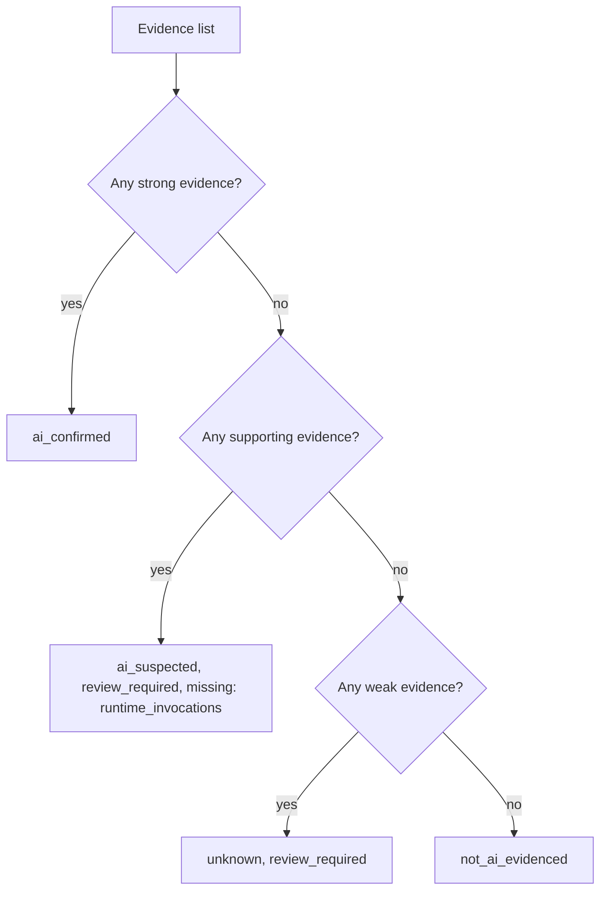
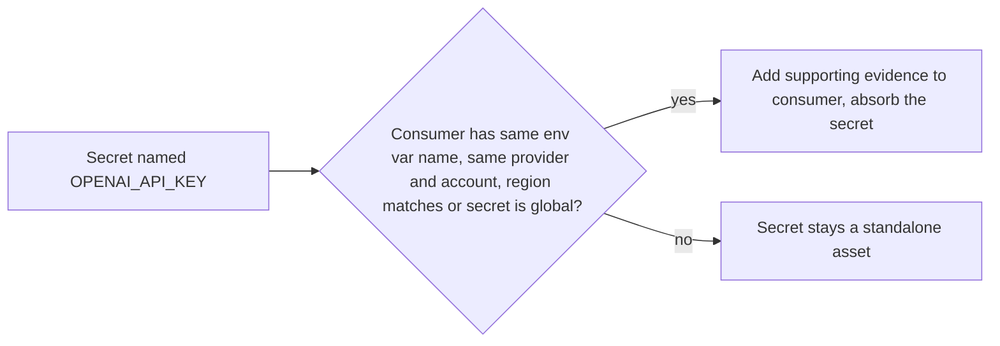
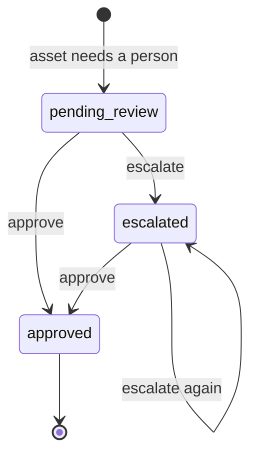

# LOGIC.md: how every decision is made

This file explains the decision rules, in the order the pipeline applies them. Each rule is
deterministic unless it says otherwise, and each one has tests. Where a number or threshold
appears, the file that holds it is named.

## 1. The pipeline at a glance

| # | Stage | Input | Output | Uses LLM? | Code |
|---|---|---|---|---|---|
| 1 | Collect | cloud account, scope | `Resource` list plus coverage | No | `collectors/` |
| 2 | Correlate | all resources | secrets linked to consumers | No | `detection/correlate.py` |
| 3 | Evidence | one resource | `Evidence` list | No | `detection/rules.py` |
| 4 | Verdict | evidence | `Finding` | No | `detection/classifier.py` |
| 5 | Inspect | ambiguous finding | revised `Finding` | **Yes, optional** | `agents/inspector.py` |
| 6 | Enrich | resource | owner, usage | No | `enrichment/` |
| 7 | Assess | finding, register match | approval, reason codes, risk | No | `governance/` |
| 8 | Persist | everything | append-only rows | No | `pipeline/scan.py` |

## 2. Evidence rules

Evidence is a clue, not a conclusion. Every record has a type, a strength, a source and a short detail.
A detail never contains a secret value.

| Evidence type | Fires when | Strength | Why this strength |
|---|---|---|---|
| `managed_ai_resource` | The service and resource type are listed as AI by nature in the catalog (SageMaker endpoint or notebook, Vertex endpoint, Azure OpenAI or ML workspace, and so on) | **strong** (from the catalog) | The resource exists to do AI |
| `managed_ai_resource` for Azure AI Search | Search service present | **supporting** | Search is often plain keyword search |
| `ai_secret_name` | An env var, app setting or secret is named like a known AI key, for example `OPENAI_API_KEY` | **supporting** | A name is a lead, not proof of any API call |
| `ai_secret_name` (correlated) | An AI-named secret and a consumer with the same name in the same scope | **supporting** | Name match only |
| `ai_dependency` | A Lambda layer name contains an AI package name on a word boundary | **supporting** | A package can be bundled and never called |
| `gpu_instance_type` | Instance family is in the catalog GPU list | **weak** | GPUs also run simulations and rendering |
| `name_hint` | The resource name contains a hint word (`llm`, `rag`, `chatbot` and so on) as a whole word | **weak** | Names mislead |

Not built: `model_invocation`, `external_api_call`, `ai_iam_permission`. The types exist in the enum,
no rule produces them yet.

Matching details:

- Name hints use whole words. `rag` matches `invoice-rag-helper` and does not match `storage`.
- Layer names use package boundaries. `openai` matches `openai-python`; `torch` does not match `torchlight`.
- Key Vault names use dashes, so names are normalised (`-` to `_`) before comparison.
- SageMaker types such as `ml.g5.xlarge` are reduced to the family `g5` before the GPU check.

## 3. Verdict rules

The classifier looks only at the strongest evidence present.

| Verdict | Meaning | Reviewer sees |
|---|---|---|
| `ai_confirmed` | Strong evidence that this resource is AI | Evidence list |
| `ai_suspected` | Credible signals, no proof AI is ever called | What would settle it |
| `unknown` | Only weak signals, or we could not inspect | A flag for review |
| `not_ai_evidenced` | No AI evidence in what we inspected | Nothing stored. This is **not** proof AI is absent |

A `Finding` with a confirmed or suspected verdict and no evidence cannot be created. The model rejects it.

### Worked examples

| Resource | Evidence found | Verdict |
|---|---|---|
| SageMaker endpoint `churn-predictor` | managed AI resource (strong) | `ai_confirmed` |
| Lambda `invoice-helper` with `OPENAI_API_KEY` env name | secret name (supporting) | `ai_suspected` |
| Lambda with layer `openai-python` | dependency (supporting) | `ai_suspected` |
| EC2 `g5.xlarge` named `gpu-worker` | GPU type (weak) | `unknown` |
| Lambda `report-builder`, no signals | none | `not_ai_evidenced` |
| Azure AI Search `docs-index` alone | managed resource (supporting) | `ai_suspected` |
| Azure OpenAI account | managed AI resource (strong) | `ai_confirmed` |

## 4. Secret correlation

An AI-named secret says something about whoever uses it. Linking is by name:

An absorbed secret is not stored separately. A secret nobody appears to use stays visible, because an
unused AI key is worth a look. The link is a name match: we never read env values, so we cannot see
which secret a function actually reads.

## 5. The LLM inspector

Only findings that are `ai_suspected` or `unknown` go to the inspector.

| Rule | Reason |
|---|---|
| Input is a compact package: service, type, name, tag **keys**, env var **names**, evidence | No tag values, no secret values |
| System prompt says all resource text is untrusted data | Prompt injection defence |
| No tools, no cloud access | It can only read what it is given |
| Allowed verdicts: `ai_suspected`, `not_ai_evidenced`, `unknown` | It can never confirm AI |
| Cited evidence ids must be ones we sent | Blocks invented evidence |
| Invalid JSON or schema counts as unusable output | Triggers escalation |
| Result is always `review_required` | A model opinion is never final |
| Its confidence is stored as `llm_confidence` | Model-reported, **not** a calibrated probability |
| If the LLM is missing or fails, the rules result stands | The LLM is optional |

If the inspector returns `not_ai_evidenced`, the asset leaves the inventory. That is intentional
and covered by a test.

## 6. Model routing

| Step | Rule |
|---|---|
| Model choice | Start on the small model |
| Escalation | Only when the output fails validation, and only once, to the large model |
| Provider error | Logged, no escalation, rules result kept |
| Budget | Checked before each call. Over budget logs `budget_blocked` and skips the call |
| Output tokens | Minimum 400, because reasoning models spend tokens thinking |
| Logging | Task, tier, model, tokens, cost, latency, outcome. No prompt text |
| Cost report | Actual cost, plus an estimate of the same requests on the large model only |

Configured in `config.py` and `.env`: model names, per-million-token prices, `LLM_BUDGET_USD` (default 0.50).

## 7. Enrichment

### Owner

| Order | Source | Stored as |
|---|---|---|
| 1 | Tag, checked in this order: `owner`, `team`, `business-owner`, `cost-center-owner` (case-insensitive, empty ignored) | `explicit_tag` |
| 2 | CloudTrail create event for the resource, last 90 days, only when no tag exists | `inferred_creator` |
| 3 | Nothing found | `unknown` |

Only `explicit_tag` counts as a verified owner. The creator may be a pipeline role, or may have left.

### Usage

| Measured value | Activity status |
|---|---|
| No metric available (`None`) | `activity_unknown` |
| Calls greater than 0 in the window | `active_observed` |
| 0 calls, earlier use known | `dormant_observed` |
| 0 calls, no earlier use known | `no_activity_observed` |

`None` and `0` mean different things: "could not measure" and "measured nothing". Usage is stored as a count
and a window (for example 4,000 in 30 days), never as a vague label. Only Lambda and SageMaker endpoints
have a metric today. A Lambda's invocations are function activity, not proof of AI calls.

## 8. Approval and risk

The register is matched on provider and **native resource id**, never on name alone. One approved system
can list several resources.

| Register result | Condition |
|---|---|
| `matched` | Found, and no differences |
| `out_of_scope` | Found, with issues: `account_mismatch`, `region_not_approved`, `owner_mismatch` |
| `not_found` | No entry for this resource |

An owner is only compared when both the register and the scan know one. An empty `approved_regions` list means any region.

| Finding | Register result | Approval status | Reason codes | Risk |
|---|---|---|---|---|
| Confirmed or suspected | `matched` | `approved` | none | low |
| Confirmed or suspected | `out_of_scope` | `governance_exception` | one per issue | medium |
| Confirmed, owner not an explicit tag | `not_found` | `potential_shadow_ai` | `not_in_approved_register`, `owner_unverified` | **high** |
| Confirmed, owner tagged | `not_found` | `potential_shadow_ai` | `not_in_approved_register` | medium |
| Suspected | `not_found` | `potential_shadow_ai` | adds `ai_use_unconfirmed` | medium |
| Unknown or not AI | any | `not_assessed` | none | unassessed |

The label says **potential** because the register may simply be out of date. A person makes the final call.
The LLM never sets risk. The table above is the policy, in `governance/shadow.py`.

## 9. Coverage

Every collector returns coverage with its resources: one record per provider, account, region and service.

| Status | When |
|---|---|
| `complete` | No errors |
| `partial` | Some resources found and some calls failed |
| `failed` | Nothing found and a call failed |

A failed or denied call becomes a coverage gap with the error code and operation. The other services still run.
A scan with any gap is stored as `partial`.

## 10. Review workflow

An asset needs a person when it is `review_required`, a potential shadow AI, or a governance exception.
Each decision adds a row with reviewer and reason. Nothing is edited, so the history is the audit trail.
Approving does not change the register. It records that someone accepted the finding.

## 11. Change detection

`/changes` compares the assets in the latest scan with the scan before it.

| Result | Meaning |
|---|---|
| New | In the latest scan, not the previous one |
| Missing | In the previous scan, not the latest |

Missing does not mean deleted. It may be deleted, moved, cleared on review, or hidden by a coverage gap.
The API says so and points to `/coverage/latest`.

## 12. How the system is judged: the eval

`evals/ground_truth.py` holds hand-written expected answers for the demo estate, written before scoring.
Resources not stored by a scan are treated as "not AI, not assessed", so negatives are tested too.

| Metric | Definition |
|---|---|
| Detection precision, recall | Positive means `ai_confirmed` or `ai_suspected`. `unknown` is not positive |
| Verdict and approval accuracy | Exact match against the label |
| Shadow AI precision, recall | Positive means `potential_shadow_ai` |
| Scopes complete, resources inspected | Coverage ratios |

Unlabelled assets that were flagged count as false positives. A ratio with nothing to measure prints `n/a`.
Tests prove the scorer can fail: breaking detection drops recall to 0, and removing the register lowers shadow precision.

This eval says the pipeline is consistent with its labels on an invented estate. It does not say it would
score the same on a real account.