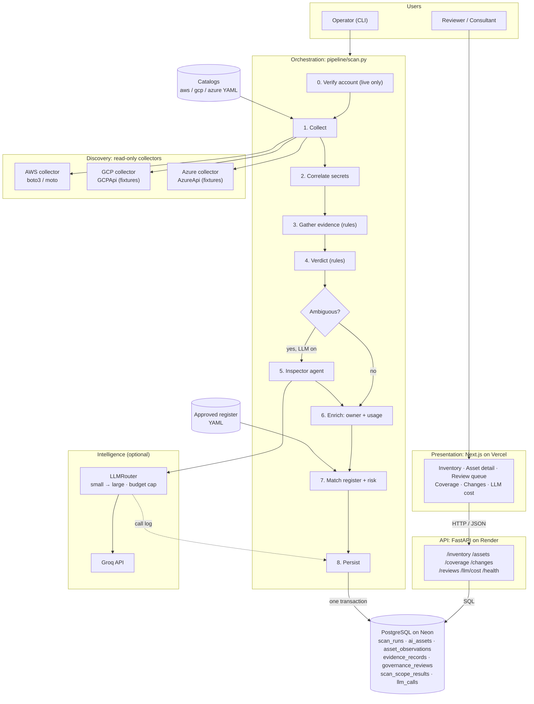
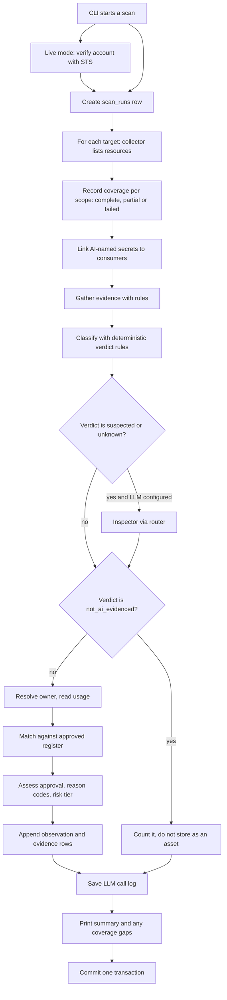
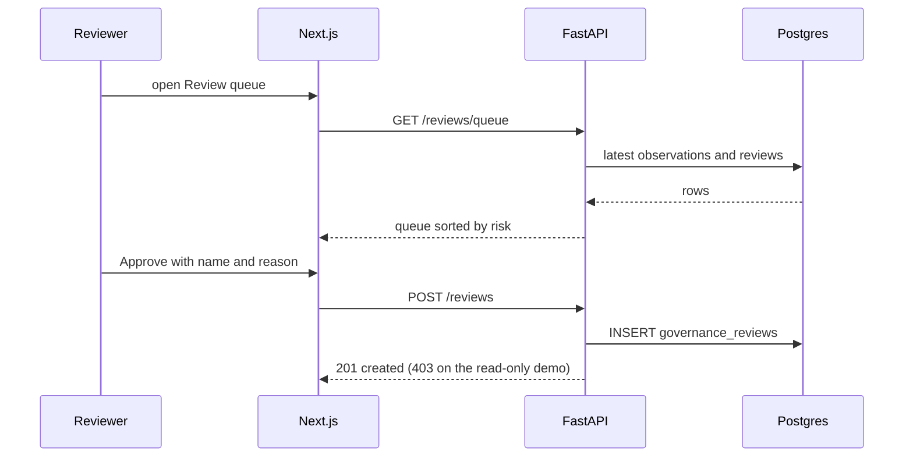
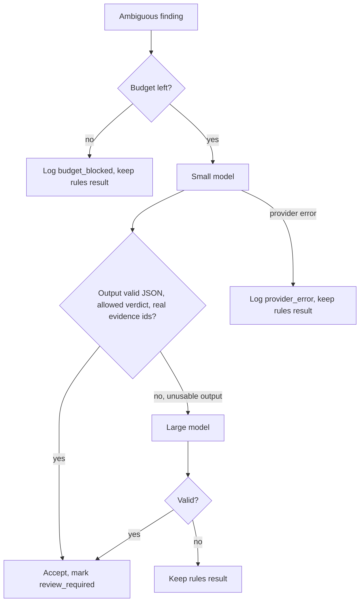

# ai-discovery-agent

Finds AI usage across AWS, GCP and Azure, builds an AI inventory aligned with the ISO/IEC 42001
(AIMS) fields, flags potential shadow AI, and routes LLM work to the cheapest model that does the job.

**Live demo (read-only, simulated data):** [add Vercel URL] | **API:** https://cloud-ai-discovery-agent.onrender.com (free instance, first load can take a minute)

| Document | What it covers |
|---|---|
| **README.md** (this file) | What it is, architecture, status, how to run it |
| [LOGIC.md](LOGIC.md) | Every decision rule: verdicts, evidence, approval, risk, routing |
| [TECHNICAL.md](TECHNICAL.md) | Modules, data model, API, security, deployment, testing, scaling |
| [docs/threat-model.md](docs/threat-model.md) | Threats and controls |
| [docs/aws-readonly-policy.json](docs/aws-readonly-policy.json) | Least-privilege IAM policy, generated from the catalog |

---

## 1. The problem

A large company has thousands of cloud resources and nobody knows which involve AI, who owns them,
whether they are used, or whether anyone approved them. This project answers that, and it keeps
three questions apart because mixing them is the usual mistake:

| Question | Field | Values |
|---|---|---|
| Is it AI? | `ai_verdict` | `ai_confirmed`, `ai_suspected`, `not_ai_evidenced`, `unknown` |
| Is it being used? | `activity_status` | `active_observed`, `dormant_observed`, `no_activity_observed`, `activity_unknown` |
| Is it approved? | `approval_status` | `approved`, `potential_shadow_ai`, `governance_exception`, `not_assessed` |

A second question from the assessment: when several agents share an application, how do you
use the right LLM for the best output at the least cost? The answer is a small router (section 6).

---

## 2. What is real, what is simulated, what was tried live

| Area | State |
|---|---|
| AWS collector (Lambda, SageMaker, EC2, Secrets Manager) | Built. Tested against **moto** (fake AWS). |
| AWS `--mode live` | **Attempted on two real new AWS accounts.** Every scope failed with `AccessDeniedException` caused by an account-level service control policy (see section 3). No live inventory was obtained. |
| GCP collector (Vertex AI, Cloud Run, Compute, Secret Manager) | Built behind an injected `GCPApi` interface. Runs on **fixture data**. No live adapter. |
| Azure collector (Cognitive Services, ML, AI Search, Web Apps, VMs, Key Vault) | Built behind an injected `AzureApi` interface. Runs on **fixture data**. No live adapter. |
| Detection, enrichment, governance | Built and unit tested. |
| LLM inspector and router | Built. Unit tested with a fake provider. Groq is the default provider. |
| Postgres, API, Next.js dashboard, review queue | Built and tested. |
| Hosted demo | Neon (Postgres), Render (API), Vercel (dashboard). Read-only, seeded from a laptop with simulated data. |
| Eval harness | Built. Labels cover the demo estate only. |
| **Bedrock collector, on-demand Bedrock discovery** | **Not built.** Design in TECHNICAL.md section 16. |
| Network/DNS evidence, SBOM scanning, SaaS discovery, IAM-permission evidence | **Not built.** |

The demo estate is invented. The hosted site shows a banner saying so.

---

## 3. Live AWS run: what actually broke

I ran the unchanged scan against a real account. Observed results are separated from predictions.

| Finding | Status |
|---|---|
| All scopes failed with `AccessDeniedException` / `UnauthorizedOperation`, from an explicit deny in a **service control policy** (not the IAM policy). The coverage layer recorded each failing call and nothing crashed. | **Observed live** |
| `--account-id` was never checked against the credentials. A wrong ID would mislabel every asset. | **Observed live. Fixed:** the CLI calls `sts:GetCallerIdentity` and refuses to scan on a mismatch. |
| Denial reasons were stored but not shown, and the summary said only "scopes w/ gaps: 4". | **Observed live. Fixed:** the CLI prints each failing operation. |
| A fully denied scan finished like a success. | **Observed live. Fixed:** a warning prints when nothing was discovered and scopes failed. |
| CloudWatch "no data" was reported as "0 calls". | **Predicted from code. Fixed:** the reader now looks up real metrics with `ListMetrics`, and no metric means unknown. Not yet confirmed live. |
| SageMaker endpoint metrics need a `VariantName` dimension we did not send. | **Predicted. Fixed** by the same lookup. Not confirmed live. |
| CloudTrail `LookupEvents` is rate limited, and we fall back to `unknown` silently. | **Predicted. Not fixed yet.** |
| The IAM policy is sufficient. Moto does not enforce IAM. | **Untested.** Needs a real run. |
| The threat model mentions assuming a role with an external ID. The code uses whatever credentials are present. | **Known gap.** |

The cause of the service control policy on the new accounts is not confirmed. My working guess is
AWS's Free Plan restrictions, which I could not lift because payment verification did not complete.

---

## 4. Architecture



### Scan workflow



### Dashboard request flow



---

## 5. Key design decisions

| Decision | Why |
|---|---|
| Rules decide first, the LLM only sees ambiguous findings | Free, repeatable and explainable. A model is used where rules cannot settle it. |
| The LLM can never return `ai_confirmed` | A manipulated or overconfident model cannot promote an asset. |
| `unknown` is a real answer | A GPU instance alone is weak evidence. We do not guess. |
| "Could not measure" is not "zero" | No CloudWatch metric means `activity_unknown`, never `no_activity_observed`. |
| Activity is separate from the verdict | An idle endpoint is still AI. |
| Owner is an explicit tag or unknown | A creator seen in CloudTrail is labelled `inferred_creator` and never counts as verified. |
| Coverage is stored and printed for every scope | A scan that finds 5 assets means little unless you know what it could not inspect. |
| Live scans verify the account first | Credentials must belong to the account being labelled. |
| Observations are append-only | Gives history, new assets and missing assets for free. |
| Collectors never see secret values | Names only. Tests search outputs and the database for planted values. |
| Collectors sit behind interfaces | Detection, governance and the API never learn which cloud a resource came from. |

---

## 6. Repository layout

```
src/ai_discovery/
  catalog/      versioned per-cloud discovery catalogs (YAML) and a typed loader
  collectors/   base contract; AWS, GCP, Azure; CloudWatch usage; CloudTrail owner hints
  models/       Resource, Evidence, Finding, coverage models, shared enums
  detection/    rules (evidence), classifier (verdict), correlate (secret linking)
  enrichment/   owner resolution, usage summary
  governance/   approved register matching, shadow AI policy
  llm/          types, Groq provider, router, factory, cost report
  agents/       inspector (LLM second opinion)
  pipeline/     scan orchestration
  db/           SQLAlchemy base, session, tables
  api/          FastAPI app
  evals/        hand-labelled ground truth and scoring
  security/     IAM policy generator
  demo/         fake AWS account and GCP/Azure fixtures
  cli.py        command line entry point
frontend/       Next.js dashboard
migrations/     Alembic migrations
data/           approved register (YAML)
docs/           threat model, generated IAM policy
tests/          pytest suite
```

---

## 7. LLM routing and cost



- Every request starts on the small model. Only unusable output escalates. A provider outage does not.
- A per-scan budget caps spend. Blocked calls are logged.
- Each call stores tier, tokens, cost, latency and outcome, never prompt text.
- The cost page shows calls per tier, escalations, actual cost and an estimated all-large cost.
  The estimate reuses the small model's token counts, and prices in `.env` are placeholders: verify them before quoting any figure.

---

## 8. Run it

Needs Python 3.11, Docker and Node 18.18 or newer.

```bash
python -m venv .venv
.venv\Scripts\activate.bat
pip install -e ".[dev]"
copy .env.example .env
docker compose up -d
alembic upgrade head

# scan all three clouds (AWS on moto, GCP and Azure on fixtures), rules only
python -m ai_discovery scan --mode mock --clouds aws gcp azure --register data/approved_register.yaml --no-llm

# API on :8000
python -m uvicorn ai_discovery.api.main:app --reload

# dashboard on :3000 (second terminal)
cd frontend
npm install
npm run dev
```

Live AWS (needs a read-only profile built from `docs/aws-readonly-policy.json`):

```bash
set AWS_PROFILE=discovery-scanner
python -m ai_discovery scan --mode live --clouds aws --account-id <ACCOUNT_ID> --regions ap-south-1 --register data/approved_register.yaml --no-llm
```

Drop `--no-llm` and set `GROQ_API_KEY` in `.env` to enable the inspector. Check Groq's console for
current model names and override `SMALL_MODEL_NAME` and `LARGE_MODEL_NAME` if needed.

Evaluation and tests:

```bash
python -m ai_discovery.evals.scoring
docker exec -it ai-discovery-db psql -U discovery -d ai_discovery -c "CREATE DATABASE ai_discovery_test;"
pytest
```

Windows notes: if SQLAlchemy fails with an Application Control DLL error, set
`DISABLE_SQLALCHEMY_CEXT_RUNTIME=1`. If `ai_discovery` cannot be imported, set `PYTHONPATH=src`.

---

## 9. API

| Method and path | Purpose |
|---|---|
| `GET /health` | Database reachable |
| `GET /inventory` | AI assets seen in the latest scan (`?include_missing=true` adds older ones) |
| `GET /assets/{asset_key}` | One asset: observation history and evidence per observation |
| `GET /coverage/latest` | What the latest scan inspected and what failed |
| `GET /changes` | New and missing assets between the last two scans |
| `GET /reviews/queue` | Assets waiting for a person, highest risk first |
| `POST /reviews` | Approve or escalate with reviewer and reason (403 when `DEMO_READ_ONLY=true`) |
| `GET /reviews/history?asset_key=` | Every decision for one asset |
| `GET /llm/cost` | LLM routing and cost report for the latest scan |

Interactive docs at `/docs`.

---

## 10. Limitations

- Mocks and fixtures carry almost all testing. The one live attempt was blocked by account policy,
  so rate limits, real IAM enforcement and pagination at scale are untested.
- Hidden AI is found from names, tags, layer names, GPU types and secret names. There is no code, SBOM,
  IAM-permission or network evidence, so quiet or well-named AI will be missed.
- **On-demand Bedrock use leaves no resource to list and is not detected yet.**
- Rules are hand-set, not calibrated on labelled real data.
- The inventory shows the latest scan only. A scan of one cloud hides the others' assets.
- The review API has no authentication, and reviewer names are self-declared.
  A later scan that changes a verdict does not reopen an earlier approval.
- A crashed scan leaves no `scan_runs` row.
- Not multi-tenant, no encryption at rest.
- Live scans use ambient credentials. Role assumption with an external ID is documented, not implemented.
- Secret-to-consumer linking is a name match, not proof of use.

## 11. Next

A Bedrock collector (listable resources plus on-demand discovery from CloudWatch metrics), a successful
live run, role assumption with an external ID, CloudTrail throttling recorded as a coverage gap,
live GCP and Azure adapters, dependency and SBOM scanning, network evidence, authentication and
tenancy, parallel scanning, and reopening reviews when a verdict changes.
