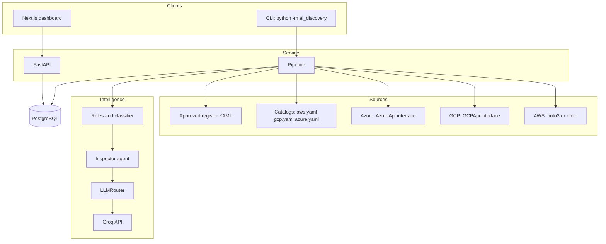
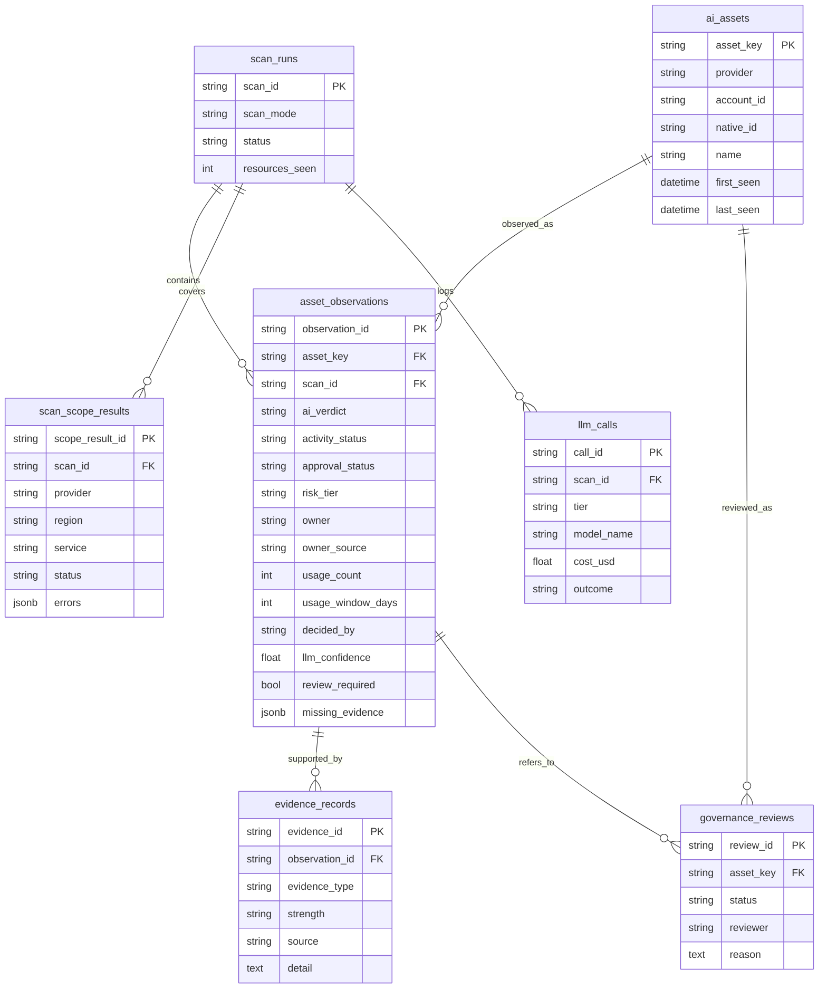
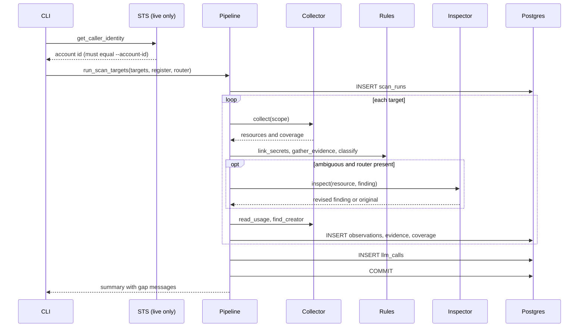
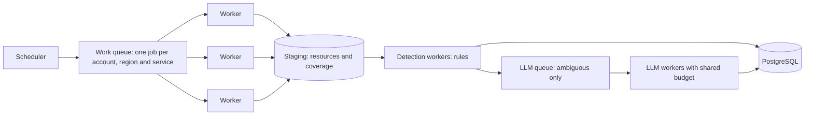

# TECHNICAL.md: architecture, data and operations

## 1. Stack

| Layer | Choice | Reason |
|---|---|---|
| Language | Python 3.11 | Matches the JD |
| Models | Pydantic v2 | Validation at every boundary |
| Cloud SDK | boto3 (AWS) | GCP and Azure sit behind interfaces |
| AWS testing | moto | Fake AWS, no account needed |
| Database | PostgreSQL 16 locally, Neon in the hosted demo | JSONB, `DISTINCT ON`, time zones |
| ORM and migrations | SQLAlchemy 2, Alembic | Typed tables, versioned schema |
| API | FastAPI | Typed responses, generated docs |
| LLM client | `openai` package pointed at Groq | One interface, swappable provider |
| Frontend | Next.js (App Router), TypeScript, Tailwind | Matches the JD |
| Hosting | Vercel (frontend), Render (API), Neon (database) | Free tiers, read-only demo |
| Tests | pytest | Unit, integration against Postgres, API |
| Packaging | `pyproject.toml`, `src/` layout | Tests run against the installed package |

## 2. System architecture



Dependency direction: collectors, detection, governance and the LLM layer do not import the database.
Only `pipeline/scan.py` and `api/main.py` touch it.

## 3. Module map

| Package | Key files | Responsibility |
|---|---|---|
| `catalog` | `*.yaml`, `loader.py` | Versioned list of services, API calls, signals. `read_operations()` feeds the IAM policy |
| `collectors` | `base.py`, `aws.py`, `gcp.py`, `azure.py`, `usage_aws.py`, `owner_hints_aws.py` | List resources, record coverage, drop secret values |
| `models` | `resource.py`, `evidence.py`, `finding.py`, `coverage.py`, `enums.py` | Shared shapes and vocabulary |
| `detection` | `rules.py`, `classifier.py`, `correlate.py` | Evidence, verdict, secret linking |
| `enrichment` | `owner.py`, `usage.py` | Owner and activity |
| `governance` | `register.py`, `shadow.py` | Register matching, approval, risk |
| `llm` | `types.py`, `providers.py`, `router.py`, `factory.py`, `report.py` | Provider interface, routing, cost report |
| `agents` | `inspector.py` | LLM second opinion with strict output |
| `pipeline` | `scan.py` | Orchestration, one transaction per scan, gap messages |
| `db` | `base.py`, `session.py`, `tables.py` | Schema and sessions |
| `api` | `main.py` | HTTP endpoints, CORS, read-only demo switch |
| `evals` | `ground_truth.py`, `scoring.py` | Labelled data and metrics |
| `security` | `iam_policy.py` | IAM policy generated from the catalog |
| `demo` | `fake_account.py`, `fixture_apis.py` | Demo data |
| `cli.py` | | Scan command, account verification, summary output |

## 4. Core contracts

### Collector

```python
class BaseCollector(ABC):
    provider: CloudProvider
    def collect(self, scope: ScanScope) -> CollectionResult: ...          # required
    def read_usage(self, resource) -> int | None: ...                     # optional
    def find_creator(self, resource) -> str | None: ...                   # optional
```

`CollectionResult` holds `resources` and `coverage` together, so a collector cannot return resources
without saying what it could not see. A failure in one service must not stop the others.

### Usage reader (AWS)

`read_invocation_count` calls `cloudwatch:ListMetrics` for the resource, then `GetMetricStatistics` for each
returned dimension set and sums them. It returns `None` when no metric exists, when the call fails, or when
the resource type has no invocation metric. It returns `0` only when a metric exists and shows nothing.

### Field mapping across clouds

| Concept | AWS | GCP | Azure |
|---|---|---|---|
| Account in `ScanScope` | account id | project id | subscription id |
| Native id | ARN | resource path | ARM resource id |
| Tags | tags | labels | tags |
| Env var names | Lambda environment keys | Cloud Run env names | Web app setting names |
| AI service | SageMaker | Vertex AI | Cognitive Services, ML workspace |
| GPU hint | `g5`, `p4d` | `a2`, `g2` | `Standard_NC*` |
| Secret names | Secrets Manager | Secret Manager (`global`) | Key Vault (dashed names) |

### LLM provider

```python
class LLMProvider(ABC):
    def complete(self, request: LLMRequest, model_name: str) -> LLMResponse: ...
```

The router only knows this interface. Tests use a fake. Swapping Groq for another provider means
one new class.

## 5. Data model



| Table | Written | Never |
|---|---|---|
| `ai_assets` | Upserted: `last_seen` moves, `first_seen` is kept | Deleted |
| `asset_observations` | Inserted once per asset per scan | Updated |
| `evidence_records` | Inserted with their observation | Updated |
| `governance_reviews` | Inserted per decision | Updated |
| `scan_scope_results`, `llm_calls` | Inserted per scan | Updated |

The asset key is `provider:native_id`, stable across scans, so "new" and "missing" can be derived.

## 6. Scan sequence



## 7. API reference

| Endpoint | Returns |
|---|---|
| `GET /health` | `{"status": "ok"}` after a `select 1` |
| `GET /inventory` | Latest observation per asset, from the latest scan. `?include_missing=true` includes older assets |
| `GET /assets/{asset_key:path}` | Asset with every observation, newest first, with evidence. 404 if unknown |
| `GET /coverage/latest` | Scope table, counts of complete and gap scopes. 404 if no scans |
| `GET /changes` | New and missing assets, with a note about why missing is not deletion |
| `GET /reviews/queue` | Assets whose latest observation needs a person and whose review is pending or escalated |
| `POST /reviews` | Body: `asset_key`, `decision` (`approve` or `escalate`), `reviewer`, `reason`. 201, 403 when `DEMO_READ_ONLY=true`, 404 for unknown asset, 422 for blank text |
| `GET /reviews/history` | All decisions for one asset |
| `GET /llm/cost` | Calls per tier, escalations, outcomes, actual and estimated costs |

CORS allows the origins in `ALLOWED_ORIGINS` (default `localhost:3000` and `127.0.0.1:3000`), for GET and POST only.

## 8. Frontend

| Route | Rendering | Data |
|---|---|---|
| `/` | Server component | `/inventory` |
| `/asset?key=` | Server component | `/assets/...`, `/reviews/history` |
| `/review` | Server page plus client form | `/reviews/queue`, `POST /reviews` |
| `/coverage` | Server component | `/coverage/latest` |
| `/changes` | Server component | `/changes` |
| `/costs` | Server component | `/llm/cost` |

`src/lib/api.ts` holds hand-written types that mirror the response models. Resource names are untrusted text,
and React escapes text, so `dangerouslySetInnerHTML` is never used. A banner on every page says the data is simulated.

## 9. Security

| Control | Where |
|---|---|
| Read-only access, policy generated from the catalog | `security/iam_policy.py`, `docs/aws-readonly-policy.json` |
| Policy includes `cloudwatch:ListMetrics` for the usage reader | `SUPPORTING_ACTIONS` |
| Explicit deny on secret values (`GetSecretValue`, SSM parameter reads) | same |
| A test fails if the committed policy drifts from the catalog | `tests/test_iam_policy.py` |
| Live scans verify the credentials' account before collecting | `cli.py` |
| Env var and setting values dropped inside the collector | `collectors/*.py` |
| Tests search outputs and the database for planted secret values | `test_aws_collector`, `test_pipeline`, `test_api` |
| Untrusted text defence for the LLM | `agents/inspector.py` |
| Error payloads reduced to a code | `CollectionError`, `ProviderError` |
| No prompt text stored | `llm_calls` columns |
| Public demo cannot be written to | `DEMO_READ_ONLY=true` makes `POST /reviews` return 403 |
| Secrets kept out of git | `.env` and `.env.*` ignored, `.env.example` has blanks |

Full table in `docs/threat-model.md`.

## 10. Configuration

| Variable | Default | Purpose |
|---|---|---|
| `DATABASE_URL` | local Postgres | Connection string (`postgresql+psycopg://...`) |
| `SCAN_MODE` | `mock` | Recorded on each scan |
| `ALLOWED_ORIGINS` | localhost:3000 and 127.0.0.1:3000 | Comma-separated CORS origins |
| `DEMO_READ_ONLY` | `false` | `true` rejects review writes |
| `GROQ_API_KEY` | empty | Empty means no LLM |
| `SMALL_MODEL_NAME`, `LARGE_MODEL_NAME` | `openai/gpt-oss-20b`, `openai/gpt-oss-120b` | Check Groq for current names |
| `*_INPUT_PRICE_PER_MILLION`, `*_OUTPUT_PRICE_PER_MILLION` | placeholders | Verify before quoting costs |
| `LLM_BUDGET_USD` | 0.50 | Per-router cap |
| `NEXT_PUBLIC_API_URL` | `http://127.0.0.1:8000` | Frontend to API |

The database engine disables prepared-statement reuse (`prepare_threshold=None`) so it works behind Neon's pooler.

## 11. Testing

| Area | Method |
|---|---|
| AWS collectors | moto, plus an injected denial for partial coverage |
| GCP, Azure collectors | Fake API classes returning realistic shapes |
| Detection, enrichment, governance, correlation | Plain unit tests |
| Router, inspector | Fake provider, no network and no cost |
| Pipeline, API, reviews, cost | Real Postgres (`ai_discovery_test`), recreated for each test |
| Evals | Full three-cloud scan scored against labels, plus tests that the scorer can fail |
| IAM policy | Read-only verbs only, secrets denied, matches catalog |
| Read-only demo | `POST /reviews` returns 403 when the switch is on |

Run `pytest`. The database fixture lives in `tests/conftest.py`. Moto does not implement CloudTrail
`LookupEvents`, so the owner-hint code treats that as "no hint" and tests use a fake session.

## 12. Deployment

| Part | Host | Notes |
|---|---|---|
| Frontend | Vercel, root directory `frontend` | `NEXT_PUBLIC_API_URL` points at the API |
| API | Render free instance | Build `pip install .`, start `uvicorn ai_discovery.api.main:app --host 0.0.0.0 --port $PORT`, needs `PYTHONPATH=/opt/render/project/src/src` (packaging gap) |
| Database | Neon | Migrated and seeded from a laptop with mock scans |
| Scans | Operator's machine | The server never runs scans and holds no cloud or LLM keys |

## 13. Failure behaviour

| Failure | Result |
|---|---|
| One cloud call is denied | That scope is `partial` or `failed` with the error code. Others continue |
| Everything denied | Scan finishes as `partial`, the CLI prints each gap and a warning |
| Credentials belong to another account | Live scan refuses to start |
| Tag lookup fails for one resource | Resource kept, scope `partial`, not counted as inspected |
| CloudWatch call fails or no metric exists | Usage stays `activity_unknown` |
| CloudTrail call fails or is throttled | Owner stays `unknown` (no coverage gap recorded yet) |
| Groq down or key missing | Rules result stands, finding stays in review |
| Model returns bad JSON | One escalation, then the rules result |
| Budget reached | Calls blocked and logged, rules result stands |
| A collector raises an unexpected error | Whole scan rolls back (one transaction), no partial data |

## 14. Scalability

Be clear on two lists. **Today** is what the code does. **Design** is how it would scale, not built.

### Today: where the limits are

| Area | Current behaviour | Limit |
|---|---|---|
| Collection | Sequential: region by region, service by service | Wall time grows with regions times services |
| Per-resource calls | One tag lookup per Lambda and SageMaker resource, a `ListMetrics` plus metric query per usage-eligible resource, one CloudTrail lookup per untagged resource | Dominant cost and rate-limit risk, roughly linear in resources |
| Paging | boto3 paginators are used for listings | Fine |
| Transaction | One transaction for the whole scan | Long transaction on a big estate, and a crash loses everything |
| API reads | Latest-observation maps built in Python for the review queue | Loads all observations of the latest scan into memory |
| Inventory query | `DISTINCT ON` over one scan | Fine with the `scan_id` and `asset_key` indexes |
| LLM | One request at a time, only for ambiguous findings | Latency adds up, but volume is small by design |
| Tenancy | None | Single client per database |

### Design: how it would scale to 20,000 or more resources



| Concern | Approach |
|---|---|
| Parallel collection | One job per scope on a queue (SQS, Celery or similar). Workers are stateless and read-only |
| Rate limits | Per-service token buckets, botocore adaptive retry mode, backoff with jitter. Throttled jobs become coverage gaps, not silent fallbacks |
| N+1 calls | Prefer bulk APIs: Resource Groups Tagging API for tags, `GetMetricData` batching for usage, skip CloudTrail unless needed |
| Failure isolation | One transaction per scope, not per scan. A scan row records which scopes finished |
| Incremental scans | Use AWS Config or change events to rescan only changed resources, with a periodic full sweep |
| Read performance | Keep a `current_assets` table updated at scan end, or a materialized view |
| Table growth | Partition observations by scan date and archive old evidence |
| LLM load | Cache by evidence hash, batch requests, shared budget across workers |
| Multi-tenancy | `tenant_id` on every table, row-level security, a read-only role per tenant, per-tenant budgets |
| Access | Cross-account role with external ID, short-lived credentials, no long-lived keys |
| Observability | Metrics per scope (duration, calls, throttles), per-call LLM cost, scan success rate |

LLM cost grows with the number of **ambiguous** resources only, which the eval measures per estate.
No percentage is claimed, because it depends on how much hidden AI an account has.

## 15. Adding a cloud or a service

| To add | Do this |
|---|---|
| A service on an existing cloud | Add it to the catalog YAML, write one `_collect_*` method that returns resources and coverage, add tests |
| A new cloud | Add `<cloud>.yaml`, implement `BaseCollector`, add the provider to `CloudProvider`. Detection, governance, storage, API and dashboard need no change |
| A live GCP or Azure adapter | Implement the `GCPApi` or `AzureApi` protocol with the real SDK. The collector stays as it is |
| A new evidence rule | Add a function to `detection/rules.py` that returns `Evidence`, add it to `gather_evidence`, add tests and labels |
| A new LLM provider | Implement `LLMProvider.complete` and build it in `llm/factory.py` |

## 16. Design: on-demand Bedrock discovery (not built)

Plain `InvokeModel` and `Converse` calls on a shared foundation model create no resource, so listing
finds nothing. Some Bedrock objects are listable (guardrails, agents, knowledge bases, custom and imported
models, inference profiles, provisioned throughput, batch jobs). Pure on-demand use needs signals:

| Signal | Tells us | Limits |
|---|---|---|
| CloudWatch `AWS/Bedrock` metrics by `ModelId` (invocations, tokens) | Which models, how often, when | No caller identity. `ListMetrics` shows only recently active metrics, so rare models need a query per known model id |
| Model invocation logging (off by default) | Caller identity, model, time | Contains prompts, so read metadata only and only with consent |
| CloudTrail data events | Who invoked what | Off by default, billed. Verify current behaviour |
| IAM policies and service-last-accessed | Roles that may call or last called Bedrock | A permission is not proof of use |
| VPC endpoint for bedrock-runtime, DNS, flow logs | A network path exists | Weak alone |
| Cost data | Spend per model | Delayed. Verify per-principal attribution |

Fit with the current design:

- Model-level activity becomes a derived asset keyed by account, region and model id, labelled "not a cloud resource".
- The existing `model_invocation` evidence type is strong, so a model with real invocations is `ai_confirmed`
  with no change to the verdict rules.
- Owner stays `unknown` unless logs or CloudTrail identify the caller, and coverage states that attribution is unavailable.
- The approved register would need model-level entries, not only resource ids.
- The same blind spot exists for Vertex on-demand Gemini and for external APIs such as OpenAI.

## 17. Known gaps

| Gap | Impact |
|---|---|
| No successful live AWS run | Rate limits, IAM sufficiency and real response shapes are untested |
| Live adapters for GCP and Azure | These clouds are fixture-only |
| No Bedrock collector, no on-demand Bedrock discovery | Bedrock use without a resource is invisible |
| CloudTrail throttling is not a coverage gap | A throttled owner lookup silently becomes `unknown` |
| No role assumption with external ID | Live scans use ambient credentials, unlike the threat model's target design |
| No code, SBOM, IAM or network evidence | Hidden AI with clean names is missed |
| No authentication on the API | Reviewer names are self-declared |
| Reviews are not reopened when a verdict changes | An old approval can outlive a new finding |
| Hand-set rules, no calibration | Strengths are engineering judgement |
| A crashed scan leaves no record | Needs a failed-scan row written outside the main transaction |
| Package is not importable after `pip install .` without `PYTHONPATH` | Render needs a workaround. Check `[tool.setuptools.packages.find]` |
| `_status_for` duplicated in AWS and GCP collectors | Use `coverage_status_for` from `collectors/base.py` |
